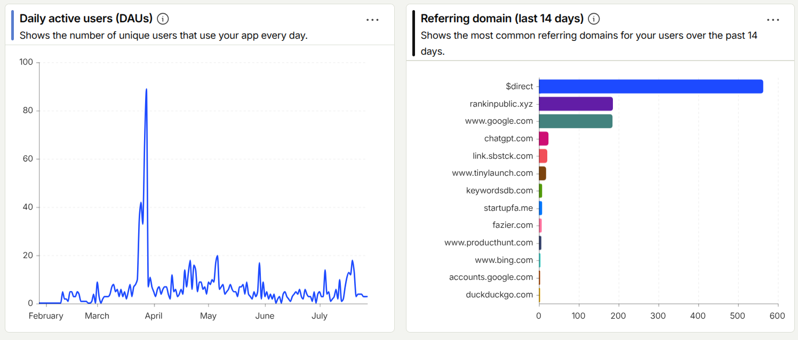
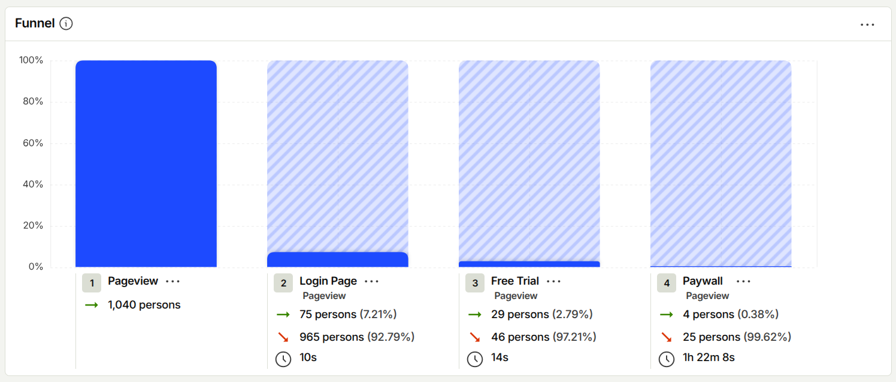
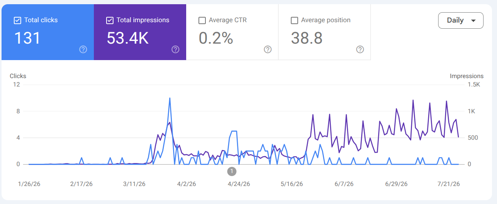
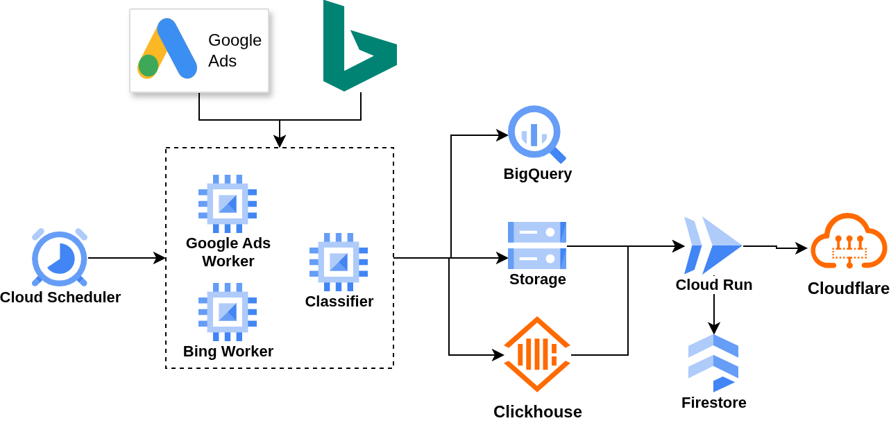

# KeywordsDB

https://keywordsdb.com

Database of 300M+ keywords from Google Search. Search, filter and sort by volume, cpc, competition and custom categories. This repo contains the whole thing: nextjs front-end, terraform resources, python data pipeline.

**[▶ Watch product demo](docs/landing.mp4)**

## Deprecated

I worked on this for about a year, launched it about 6 months ago, got about 30 users on free trial and 0 conversions. It was fun making the database work, it was costing me like 5$/month, but not sure there's a future here.









## Terraform

```
cd tf
gcloud auth application-default login
gh auth login
terraform apply
```

## Webapp

```
cd webapp
bun install
bun lint
bun dev
```

## Worker

```
cd worker
uv venv
uv sync
```
